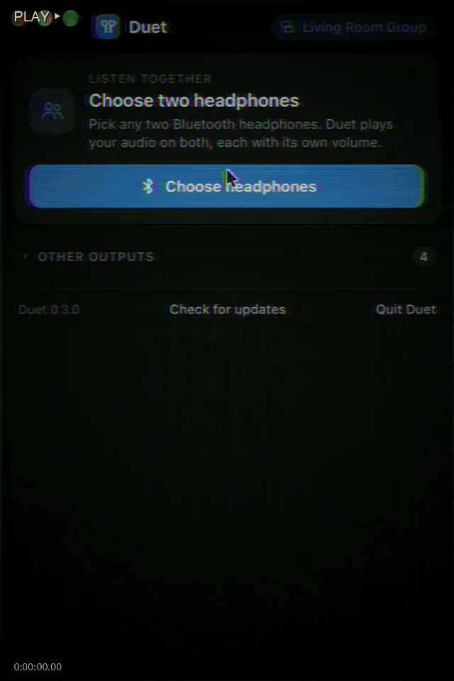

# Duet

[](https://github.com/EricMarcantonio/duet/actions/workflows/ci.yml)
[](https://github.com/EricMarcantonio/duet/releases/latest)
[](https://github.com/EricMarcantonio/duet/releases)
[](LICENSE)


**Two pairs of headphones, one computer, separate volumes.**

Duet plays your computer's audio on two pairs of AirPods (or any Bluetooth headphones)
at once, with a separate volume for each pair, plus AirPods battery levels.
It lives in the macOS menu bar (Windows system tray / Linux tray icon on the experimental
builds), works fully offline, and is a single small Rust app.

**Homepage:** <https://ericmarcantonio.github.io/duet/> (Rust + WebAssembly, in [`site/`](site/)).

## Demo

<p align="center">
  <a href="docs/demo.mp4">
    
  </a>
</p>

A second pair is ticked and connects (the row shows **Connecting…**), then both play through
the single **Duet** output with their own volumes — Alex's card is dragged to 74 %. The
capture is the real app in its mock mode, recorded by [`scripts/demo-vhs.sh`](scripts/demo-vhs.sh):
the window is captured at **1280 × 1920 px** (the app renders at 2× page zoom, so this is real
detail, not an upscale) and shown here at half that size, with the window's rounded corners
flattened onto the panel's own background. The [MP4](docs/demo.mp4) is the same take at full
size. The cards say *Noise control: Control Center › Sound* because that is what macOS does —
Duet only offers the switcher where the OS allows it (Linux); see [Status](#status).

## Install

### Homebrew (cask)

```sh
brew install --cask EricMarcantonio/duet/duet
```

Homebrew 7 will not load a cask from a third-party tap until you trust it once:

```sh
brew trust ericmarcantonio/duet
```

Use the tap-qualified name above. Homebrew's core `homebrew-cask` already ships a cask
called `duet` (Duet Display, the iPad-as-a-second-screen tool), so a bare
`brew install --cask duet` installs that app, not this one.

Duet's **Check for updates** notices when you installed through Homebrew and offers
`brew upgrade --cask duet`. The cask itself lives in
[`packaging/homebrew/duet.rb`](packaging/homebrew/duet.rb) and is mirrored to
[`EricMarcantonio/homebrew-duet`](https://github.com/EricMarcantonio/homebrew-duet);
[`packaging/homebrew/README.md`](packaging/homebrew/README.md) covers maintaining it.

### macOS 11+ (Apple Silicon & Intel)

[Duet-macOS.zip](https://github.com/EricMarcantonio/duet/releases/latest/download/Duet-macOS.zip)

The app isn't notarized, so the first launch needs right-click › Open (or System
Settings › Privacy & Security › Open Anyway). All builds: [Releases](https://github.com/EricMarcantonio/duet/releases).

### Windows / Linux (experimental)

- Windows 10/11: [Duet-Windows.zip](https://github.com/EricMarcantonio/duet/releases/latest/download/Duet-Windows.zip)
- Linux: [Duet-Linux.tar.gz](https://github.com/EricMarcantonio/duet/releases/latest/download/Duet-Linux.tar.gz)

These builds compile in CI and run the same unit tests there, but have **not been run on
real hardware yet** — see [Status](#status).

### From source (macOS)

```sh
./scripts/bundle-macos.sh --install   # universal (Apple Silicon + Intel), copies to ~/Applications
./scripts/bundle-macos.sh --zip       # dist/Duet-macOS.zip to send to someone
open ~/Applications/Duet.app
```

Sharing: the zip is ad-hoc signed, so on another Mac the first launch needs right-click › Open
(or System Settings › Privacy & Security › Open Anyway). With an Apple Developer ID, set
`SIGN_IDENTITY` and `NOTARY_PROFILE` and the script signs and notarizes it so it opens normally.

The first time it runs, allow Bluetooth access when asked. If you miss the prompt,
go to System Settings › Privacy & Security › Bluetooth. To start Duet at login, add it
in System Settings › General › Login Items.

## Use

<p align="center">
  <picture>
    <source media="(prefers-color-scheme: dark)" srcset="docs/screenshot-dark.png">
    
  </picture>
</p>

- **Click the menu bar headphones icon** to show or hide the panel (Quit is at the bottom of the panel; on Linux the tray menu has Open Duet / Quit).
  Drag its header to move it; close it with × or Esc. Opening Duet.app again also shows it.
- **Choose headphones…** lists every paired Bluetooth audio device. Tick any two (or more):
  Duet connects them and they become listeners. Until you choose, Duet uses whatever
  Bluetooth headphones are connected.
- **Listen together** (or **Connect & listen together**) connects any chosen headphones that
  aren't connected, then plays through one output called **"Duet"** (the only thing Duet adds to
  the system Sound menu). Changing your headphones updates that same output; Duet never
  touches Multi-Output devices you made yourself in Audio MIDI Setup. While you're listening
  together, if macOS switches the output to a pair that just connected (it does that for
  AirPods), Duet switches it back so nobody drops out. Pick another output in Duet (or the
  Sound menu) and it stops.
- **Each listener card**: its own volume slider (the Mac's volume keys don't work on
  Multi-Output devices), Mute and presets, and battery (left/right/case). Click a name to rename it.
- **Noise control** is switchable inside Duet only where the OS allows it (Linux, over Apple's
  AAP protocol). On macOS, Apple keeps that Bluetooth channel to itself — the card says
  "Noise control: Control Center › Sound" and you switch Off / Transparency / Adaptive /
  Noise Cancellation there. Windows exposes no API for it at all.
- **Other outputs** lets you go back to just the speakers or one pair.
- **Check for updates** in the panel footer asks GitHub for the latest release and says either
  *Up to date* or *0.3.0 available* — with a download link, or with the `brew upgrade --cask duet`
  command to run when Duet came from the cask. Nothing polls; the link is the only trigger, and a
  failed check stays in the footer as *Couldn't check* (hover for the reason).

While listening together Duet also moves the default **microphone** off the AirPods to the
built-in mic: an AirPods mic forces call-quality mode, which keeps knocking that pair out of the
Duet output and makes macOS flip the output between Duet and one pair.

**Log:** `~/Library/Logs/Duet/duet.log` (Windows `%LOCALAPPDATA%\Duet\duet.log`, Linux
`~/.local/share/Duet/duet.log`) records output switches, devices coming and going, connects,
and every time Duet re-selects its output.

Settings (nicknames, chosen headphones) live in `~/Library/Application Support/Duet/config.json`
(`%APPDATA%\Duet` on Windows, `~/.config/Duet` on Linux).

### What it uses from each OS

Duet is one Rust binary; the window is drawn by the OS's own web view (WebKit on macOS,
WebView2 on Windows, WebKitGTK on Linux), and everything else goes through system APIs:

| | Audio | Bluetooth | Noise control & battery |
|---|---|---|---|
| macOS | CoreAudio (Multi-Output device) | IOBluetooth | battery readable; noise control only in Control Center (macOS keeps that channel) |
| Windows | WASAPI + Duet's own audio mirror | WinRT Bluetooth (list only) | none (Windows exposes no API for it) |
| Linux | PulseAudio/PipeWire `module-combine-sink` | `bluetoothctl` | Apple's AAP protocol over L2CAP (as in LibrePods) — experimental |

## Platforms

| | Tray | Two pairs at once | Connect headphones |
|---|---|---|---|
| macOS | Menu bar (no Dock icon) | CoreAudio Multi-Output device | IOBluetooth |
| Windows 10/11 | Notification area | Duet mirrors audio in software (WASAPI loopback); the second pair runs ~20–60 ms behind | Opens Bluetooth settings (no public API) |
| Linux | StatusNotifierItem / AppIndicator | PulseAudio / PipeWire `module-combine-sink` | `bluetoothctl` |

Windows and Linux backends compile and have parser/unit tests, but **have not been run on real
hardware yet**. Linux needs `pactl` (with `pipewire-pulse` on PipeWire systems), `bluetoothctl`,
and the WebKitGTK/GTK + libayatana-appindicator dev packages to build. Build those with
`dx bundle --release --platform desktop` on the target OS.

## Status

- **macOS 11+** — developed and tested on real hardware: menu bar panel, CoreAudio
  Multi-Output, IOBluetooth, AirPods battery levels.
- **Windows 10/11** — experimental: compiles in CI and has unit tests for the audio-mirror and
  Bluetooth code; never run on real hardware.
- **Linux** — experimental: compiles in CI and has unit tests for the PulseAudio and AAP code;
  never run on real hardware.

The badges above report the CI workflow and the latest release, not hardware verification —
CI builds all three platforms but runs the test suite on macOS only.

## Develop

```sh
cargo test                       # unit + live CoreAudio tests (read-only except a speaker volume round-trip it restores)
cargo test -- --ignored          # also create/destroy a temp multi-output and switch outputs (restored)
DUET_MOCK=1 cargo run            # fake devices; variants: full, new, hint, nomulti, flaky
swift scripts/make-icon.swift    # regenerate assets/icon/* (app icon, .icns, .ico)
scripts/demo-vhs.sh              # re-record the README demo (ffmpeg + cliclick) → docs/demo.gif, docs/demo.mp4
scripts/update-cask.sh v0.3.0    # re-pin packaging/homebrew/duet.rb to a released tag
DUET_WINDOWED=1 cargo run        # normal window instead of the menu bar popover
cargo run --example probe        # print output devices + paired Bluetooth devices
```

`scripts/demo-vhs.sh` produces the README demo: it drives the real mock build with
`cliclick`, records the window's rect with `screencapture -v` and writes `docs/demo.gif`
and `docs/demo.mp4` (~15 seconds; needs Screen Recording + Accessibility permission, and the
window must be on the visible desktop). `DEMO_LOOK=vhs` brings back the tape grade,
`DEMO_ZOOM` sets the render scale, and `DEMO_DRY_RUN=1` prints every command it would run.

Commits on `main` must be signed: the repository enforces
`required_signatures` (Settings › Rules), so a branch or tag you push with
`git commit -S` / a configured signing key is the only kind that lands. Set it up
once with `git config commit.gpgsign true` and `git config tag.gpgsign true`.

Code layout: `src/audio/` (shared model + per-OS backends + mocks), `src/ui/` (Dioxus
components, tray, pure logic in `logic.rs`), `src/update.rs` (release comparison, the only
network call), `src/config.rs`, `assets/main.css`.
The homepage is a separate Dioxus web (WebAssembly) crate in [`site/`](site/README.md).

Releases: pushing a `v*` tag runs `.github/workflows/release.yml`, which builds the macOS
universal app, Windows and Linux, and attaches `Duet-macOS.zip`, `Duet-Windows.zip` and
`Duet-Linux.tar.gz` to the GitHub release. Afterwards run `scripts/update-cask.sh vX.Y.Z` so
the cask in `packaging/homebrew/` points at the new artifact's digest.

## License

[MIT](LICENSE)
